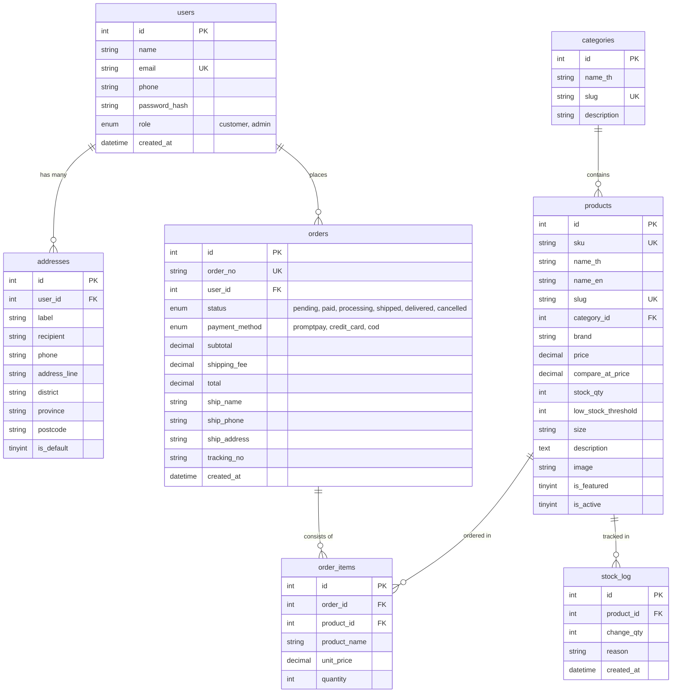

# Mochi Vita (โมจิ วิต้า) — ระบบร้านค้าออนไลน์สำหรับวิตามินและอาหารเสริม

เว็บแอปพลิเคชันร้านค้าออนไลน์ขายวิตามินและสารอาหารเสริม **Mochi Vita** พัฒนาขึ้นโดยใช้สถาปัตยกรรมที่เข้าใจง่าย ทรงพลัง และปลอดภัย เหมาะสำหรับการเรียนการสอนและแลปรายวิชา E-Commerce โดยรองรับการใช้งานจริงตั้งแต่กระบวนการเลือกซื้อสินค้า ตะกร้าสินค้า การสั่งซื้อแบบ Atomic DB Transaction ไปจนถึงระบบหลังบ้านสำหรับผู้ดูแลระบบอย่างครบวงจร

---

## 🌐 ลิงก์เข้าสู่เว็บไซต์ (Live Demo & Deployment Links)

สามารถคลิกเปิดเข้าชมและทดสอบระบบได้ทันทีผ่านลิงก์สาธารณะ (Deployed Live via Cloudflare Tunnel) หรือผ่าน Localhost:

* 🛍️ **เข้าสู่หน้าร้านค้าออนไลน์ (Live Storefront)**:  
  👉 **[https://pace-adjusted-improvements-supplemental.trycloudflare.com/E-Commerce/public/](https://pace-adjusted-improvements-supplemental.trycloudflare.com/E-Commerce/public/)**
* 🔑 **หน้าเข้าสู่ระบบ (Login)**:  
  👉 **[https://pace-adjusted-improvements-supplemental.trycloudflare.com/E-Commerce/public/login.php](https://pace-adjusted-improvements-supplemental.trycloudflare.com/E-Commerce/public/login.php)**
* 📊 **ระบบหลังบ้านผู้ดูแลระบบ (Admin Dashboard)**:  
  👉 **[https://pace-adjusted-improvements-supplemental.trycloudflare.com/E-Commerce/admin/](https://pace-adjusted-improvements-supplemental.trycloudflare.com/E-Commerce/admin/)**
* 💻 **การเข้าใช้งานผ่าน Localhost (สำหรับรันบนเครื่อง XAMPP)**:  
  👉 **[http://localhost/E-Commerce/public/index.php](http://localhost/E-Commerce/public/index.php)**

> **จุดเด่นด้านดีไซน์ล่าสุด**:
> - 🎨 **ธีมสีฟ้าและเขียวอ่อนละมุน**: ออกแบบให้อ่านสบายตา มี Contrast คมชัด ชัดเจน ไม่กลืนกับพื้นหลัง
> - 🌿 **รูปภาพสินค้า 3D Realistic Vector SVG**: อัปเดตรูปสินค้าทั้ง 31 รายการให้มีมิติ แสงเงา ฉลาก และขวดบรรจุภัณฑ์เสมือนจริง

---

## 📌 สารบัญ (Table of Contents)
1. [ลิงก์เข้าสู่เว็บไซต์ (Live Demo & Deployment Links)](#-ลิงก์เข้าสู่เว็บไซต์-live-demo--deployment-links)
2. [ภาพรวมของเว็บไซต์ (Project Overview)](#ภาพรวมของเว็บไซต์-project-overview)
3. [สถาปัตยกรรม Frontend และ Backend](#สถาปัตยกรรม-frontend-และ-backend)
4. [ฟีเจอร์หลักทั้ง 6 ส่วน (Key Features)](#ฟีเจอร์หลักทั้ง-6-ส่วน-key-features)
5. [โครงสร้างไดเรกทอรีและไฟล์ (Project Structure)](#โครงสร้างไดเรกทอรีและไฟล์-project-structure)
6. [ขั้นตอนการติดตั้งและการเปิดรันหน้าเว็บ (How to Setup & Run)](#ขั้นตอนการติดตั้งและการเปิดรันหน้าเว็บ-how-to-setup--run)
7. [บัญชีผู้ใช้งานสำหรับทดสอบระบบ (Test Accounts)](#บัญชีผู้ใช้งานสำหรับทดสอบระบบ-test-accounts)
8. [แผนผังฐานข้อมูล (Entity-Relationship Diagram)](#แผนผังฐานข้อมูล-entity-relationship-diagram)
9. [กลไกการทำงานเชิงลึก (Deep Dive Mechanisms)](#กลไกการทำงานเชิงลึก-deep-dive-mechanisms)
10. [รายการทดสอบระบบ (Manual Test Checklist & Results)](#รายการทดสอบระบบ-manual-test-checklist--results)
11. [ข้อจำกัดและสมมติฐานของระบบ (Known Limitations & Assumptions)](#ข้อจำกัดและสมมติฐานของระบบ-known-limitations--assumptions)

---

## 🌿 ภาพรวมของเว็บไซต์ (Project Overview)
**Mochi Vita** ออกแบบมาเพื่อตอบโจทย์ผู้รักสุขภาพ โดยมีผลิตภัณฑ์ครอบคลุม 8 หมวดหมู่ รวม 31 รายการ อาทิ วิตามินรวม, วิตามินซีและเสริมภูมิคุ้มกัน, แร่ธาตุ, โอเมก้า-3 จากปลาและสาหร่าย, โพรไบโอติก, คอลลาเจนและบำรุงผิว, ข้อต่อและกระดูก, และโปรตีนเสริมการออกกำลังกาย

ตัวระบบปฏิบัติตามกฎหมายผลิตภัณฑ์เสริมอาหารอย่างเคร่งครัด โดยมีข้อความระบุชัดเจนว่า:
> *"ผลิตภัณฑ์เสริมอาหารไม่ใช่ยา ไม่ได้มีไว้เพื่อวินิจฉัย รักษา หรือป้องกันโรค ควรกินอาหารหลากหลายครบ 5 หมู่ ในสัดส่วนที่เหมาะสมเป็นประจำ"*

---

## ⚙️ สถาปัตยกรรม Frontend และ Backend

### 1. Frontend Architecture
- **HTML5 & Semantic Markup**: โครงสร้างเอกสารมาตรฐาน รองรับ SEO และการเข้าถึงง่าย
- **Bootstrap 5 (CDN)**: ออกแบบ Responsive Mobile-First รองรับการแสดงผลทุกขนาดหน้าจอ (สมาร์ตโฟน, แท็บเล็ต, เดสก์ท็อป)
- **Bootstrap Icons (CDN)**: ไอคอนสื่อสารสถานะ ปุ่มกด และหมวดหมู่สินค้า
- **Google Fonts ('Prompt')**: แบบอักษรภาษาไทยสไตล์โมเดิร์น สบายตาและเป็นทางการ
- **Vanilla JavaScript**: จัดการอินเตอร์แอ็กชันหน้าเว็บ การตรวจสอบฟอร์ม การยืนยันก่อนลบ (Confirm Dialog) และการอัปเดตช่องกรอกเลขพัสดุ
- **Chart.js (CDN)**: เรนเดอร์กราฟสถิติยอดขายรายวัน 30 วัน (Line Chart) และกราฟสัดส่วนยอดขายตามหมวดหมู่ (Doughnut Chart)
- **Custom CSS (`assets/css/custom.css`)**: ธีมสีพาสเทลสะอาดตา สื่อถึงสุขภาพ ความเป็นธรรมชาติ และความน่าเชื่อถือ

### 2. Backend Architecture
- **PHP 8 (Native OOP / Functional)**: โค้ดสะอาด ไม่มี Framework หนัก (No Laravel) เพื่อให้นักศึกษาสามารถศึกษาและไล่โค้ดได้ง่าย
- **MySQL / MariaDB via PDO**:
  - ใช้ **Prepared Statements ทุก Query 100%** ป้องกัน SQL Injection อย่างเด็ดขาด
  - กำหนด Charset เป็น `utf8mb4` รองรับภาษาไทยสมบูรณ์
  - ตั้งค่า `PDO::ATTR_ERRMODE => PDO::ERRMODE_EXCEPTION` เพื่อการจัดการข้อผิดพลาดที่มีประสิทธิภาพ
- **ระบบความปลอดภัย (Security Layer)**:
  - **CSRF Protection**: ตรวจสอบโทเคนสุ่มแบบเข้ารหัสความปลอดภัยสูงในทุกฟอร์มคำขอแบบ `POST` ด้วยฟังก์ชัน `hash_equals()`
  - **Password Hashing**: เข้ารหัสผ่านด้วยฟังก์ชันมาตรฐานสากล `password_hash($pass, PASSWORD_DEFAULT)` และตรวจสอบด้วย `password_verify()`
  - **Session Fixation Prevention**: สั่งทำงาน `session_regenerate_id(true)` ทันทีหลังยืนยันการเข้าสู่ระบบ
  - **XSS Prevention**: ผ่านการกรองและ Escape ข้อมูลด้วย `htmlspecialchars()` ทุกจุดแสดงผล
  - **Atomic DB Transactions**: ในขั้นตอน Checkout และการยกเลิกคำสั่งซื้อ เพื่อป้องกันข้อมูลไม่สอดคล้องกัน (Data Inconsistency)

---

## 🚀 ฟีเจอร์หลักทั้ง 6 ส่วน (Key Features)

### 1) Product Catalog (การแสดงและค้นหาสินค้า)
- **หน้าแรก (`public/index.php`)**: Hero Banner ประชาสัมพันธ์โปรโมชันส่งฟรีเมื่อช้อปครบ 999 บาท, แสดงการ์ดหมวดหมู่ 8 หมวด, รายการสินค้าแนะนำ (`is_featured=1`), และข้อความคำเตือนตาม พ.ร.บ. อาหาร
- **หน้ารวมสินค้า (`public/products.php`)**:
  - Grid แสดงสินค้าแบบ Responsive พร้อมป้ายสถานะ (สินค้าหมด, สต็อกเหลือน้อย, ป้ายลดราคา)
  - ค้นหาด้วยคำค้น (ชื่อภาษาไทย, ชื่อภาษาอังกฤษ, แบรนด์, หรือ SKU)
  - ตัวกรองตามหมวดหมู่ และช่วงราคาต่ำสุด - สูงสุด
  - จัดเรียงลำดับตาม: มาใหม่ล่าสุด, ราคาต่ำไปสูง, ราคาสูงไปต่ำ, และชื่อตามตัวอักษร
  - แบ่งหน้า (Pagination) แสดงผลหน้าละ 12 รายการ
  - ซ่อนสินค้าที่ปิดการขาย (`is_active=0`) อัตโนมัติ
- **หน้ารายละเอียดสินค้า (`public/product-detail.php`)**:
  - ภาพสินค้าความละเอียดสูง (พร้อมระบบ Fallback หากไม่พบรูปภาพ)
  - ขนาดบรรจุภัณฑ์, ข้อมูลสต็อกคงเหลือแบบเรียลไทม์, รายละเอียดและวิธีรับประทาน
  - ช่องระบุจำนวนและปุ่มเพิ่มลงตะกร้า (ปิดการกดสั่งซื้อหากสินค้าหมด)
  - แสดงสินค้าที่เกี่ยวข้องในหมวดหมู่เดียวกัน

### 2) Shopping Cart & Checkout (ตะกร้าสินค้าและการสั่งซื้อ)
- **ตะกร้าสินค้า (`public/cart.php`)**:
  - จัดเก็บข้อมูลใน Session ผู้ใช้งานที่ยังไม่ได้ล็อกอินสามารถเลือกเพิ่มสินค้าได้ทันที
  - เพิ่ม/ลด/ลบสินค้า พร้อมตรวจสอบสต็อกแบบเรียลไทม์ไม่ให้สั่งซื้อเกินสต็อก
  - แสดงยอดรวมย่อย (Subtotal)
  - คำนวณค่าจัดส่งอัตโนมัติ: **จัดส่งฟรีเมื่อยอดครบ 999.00 บาท** (หากไม่ถึงคิด 50.00 บาท)
- **การสั่งซื้อและชำระเงิน (`public/checkout.php`)**:
  - บังคับเข้าสู่ระบบก่อนทำรายการ
  - เลือกที่อยู่จัดส่งจากสมุดที่อยู่ หรือกรอกที่อยู่ใหม่พร้อมตัวเลือกบันทึกลงสมุดที่อยู่
  - เลือกวิธีชำระเงินจำลอง: พร้อมเพย์ (PromptPay QR), บัตรเครดิต/เดบิต, หรือเก็บเงินปลายทาง (COD)
  - **DB Transaction**: ตรวจสอบสต็อกล่าสุดด้วย `SELECT ... FOR UPDATE`, สร้างเลขออเดอร์ `MV-yymmdd-0001`, บันทึก `orders`, บันทึก `order_items` (บันทึกชื่อสินค้าและราคา ณ วินาทีสั่งซื้อ), หักสต็อกสินค้า, บันทึก `stock_log` (reason = `order`), และล้างตะกร้าสินค้า
- **หน้าขอบคุณ (`public/order-success.php`)**: แสดงสรุปเลขออเดอร์ ยอดชำระ ที่อยู่จัดส่ง และ QR Code จำลองสำหรับ PromptPay

### 3) Order Management (การจัดการคำสั่งซื้อสำหรับแอดมิน)
- **หน้าตารางคำสั่งซื้อ (`admin/orders.php`)**:
  - ค้นหาด้วยหมายเลขออเดอร์ หรือชื่อลูกค้า
  - กรองตามสถานะ (`pending`, `paid`, `processing`, `shipped`, `delivered`, `cancelled`) และช่วงวันที่
  - แสดงป้ายสีตามสถานะอย่างชัดเจน และระบบแบ่งหน้า Pagination
- **หน้ารายละเอียดออเดอร์ (`admin/order-detail.php`)**:
  - ตรวจสอบรายการสินค้า ที่อยู่จัดส่ง และช่องทางชำระเงิน
  - เปลี่ยนสถานะออเดอร์: `pending → paid → processing → shipped → delivered` และ `cancelled`
  - หากเลือกสถานะ `shipped` มีช่องสำหรับกรอกหมายเลขพัสดุ (`tracking_no`)
  - **คืนสต็อกอัตโนมัติ**: เมื่อยกเลิกออเดอร์ที่ยังไม่ได้จัดส่ง (`shipped`) ระบบจะคืนสต็อกสินค้าเข้าคลัง พร้อมบันทึก `stock_log` (reason = `cancel`) โดยป้องกันการคืนสต็อกซ้ำ

### 4) Customer Accounts (ระบบบัญชีผู้ใช้งาน)
- **สมัครสมาชิก (`public/register.php`)**: ตรวจสอบชื่อ, อีเมลไม่ซ้ำ, เบอร์โทรศัพท์, รหัสผ่าน ≥ 8 ตัวอักษร, และการยืนยันรหัสผ่าน
- **เข้าสู่ระบบ / ออกจากระบบ (`public/login.php`, `public/logout.php`)**: ตรวจสอบสิทธิ์และแยกเส้นทาง (แอดมินไป `/admin/`, ลูกค้าไป `/public/`)
- **ข้อมูลส่วนตัว (`public/profile.php`)**: แก้ไขชื่อ-นามสกุล เบอร์โทรศัพท์ และเปลี่ยนรหัสผ่าน
- **สมุดที่อยู่ (`public/addresses.php`)**: เพิ่ม แก้ไข ลบ และกำหนดที่อยู่จัดส่งเริ่มต้น
- **ประวัติการสั่งซื้อ (`public/orders.php`)**: ตรวจสอบออเดอร์ของตนเอง ติดตามสถานะและเลขพัสดุ โดยมีระบบความปลอดภัยป้องกันไม่ให้ดูออเดอร์ของผู้อื่น

### 5) Admin Dashboard (แดชบอร์ดสรุปภาพรวมผู้ดูแลระบบ)
- หน้า `/admin/index.php` เข้าได้เฉพาะบัญชีที่มีบทบาท `role = admin` เท่านั้น
- **KPI Summary Cards**: ยอดขายวันนี้, ยอดขายเดือนนี้ (ไม่นับออเดอร์ที่ยกเลิก), จำนวนออเดอร์รอดำเนินการ, จำนวนสมาชิกลูกค้า, และจำนวนสินค้าสต็อกต่ำ
- **กราฟ Chart.js**: กราฟเส้นแสดงยอดขายรายวัน 30 วันล่าสุด และกราฟวงกลมแสดงสัดส่วนยอดขายตามหมวดหมู่
- **Top 5 Bestsellers**: 5 อันดับสินค้าขายดีที่สุด (คำนวณจากจำนวนชิ้นที่จำหน่ายได้)
- **ตารางออเดอร์ล่าสุด**: 10 รายการล่าสุดพร้อมปุ่มเปิดดูรายละเอียด
- **กล่องแจ้งเตือนสต็อกต่ำ**: แสดงรายการสินค้าที่คงเหลือน้อยกว่าหรือเท่ากับเกณฑ์ พร้อมปุ่มกดไปปรับสต็อกด่วนได้ทันที

### 6) Inventory Management (การจัดการคลังสินค้า)
- **หน้ารายการสินค้า (`admin/products.php`)**: ตารางสินค้าครบทุกรายการ ตัวกรองหมวดหมู่ ตัวกรองสต็อกต่ำ/หมดสต็อก และไฮไลต์แถวสีเหลือง/แดงสำหรับสินค้าที่สต็อกต่ำกว่าเกณฑ์
- **เพิ่ม/แก้ไขสินค้า (`admin/product-form.php`)**: กำหนดรหัส SKU (ตรวจสอบไม่ซ้ำ), ชื่อไทย, ชื่ออังกฤษ, สร้าง Slug อัตโนมัติ, หมวดหมู่, แบรนด์, ราคาขาย, ราคาเดิม, สต็อก, เกณฑ์แจ้งเตือนสต็อกต่ำ, ขนาดบรรจุ, คำอธิบาย, เปิด/ปิดการขาย, และระบบอัปโหลดรูปภาพ (ตรวจสอบนามสกุล jpg/png/webp ขนาด ≤ 2MB)
- **ลบสินค้าอย่างปลอดภัย (`admin/product-delete.php`)**: หากสินค้าเคยมีประวัติการสั่งซื้อ ระบบจะทำการ **Soft Delete** โดยตั้งค่า `is_active=0` (ปิดการขาย) เพื่อคงประวัติคำสั่งซื้อเดิมไว้
- **ปรับสต็อกด่วน (`admin/stock-adjust.php`)**: ปรับเพิ่ม/ลดจำนวนสต็อก พร้อมระบุเหตุผลและบันทึกประวัติลงตาราง `stock_log`
- **จัดการหมวดหมู่ (`admin/categories.php`)**: เพิ่ม แก้ไข และลบหมวดหมู่ (ระบบจะไม่อนุญาตให้ลบหากยังมีสินค้าผูกอยู่ในหมวด)

---

## 📁 โครงสร้างไดเรกทอรีและไฟล์ (Project Structure)

```
E-Commerce/
├── config/
│   ├── config.php                 # ไฟล์ตั้งค่าฐานข้อมูลและค่าคงที่ของระบบ (ไม่ถูก commit รหัสผ่านจริง)
│   └── config.sample.php          # ไฟล์ตัวอย่างสำหรับการตั้งค่า
├── database/
│   ├── schema.sql                 # คำสั่งสร้างฐานข้อมูล mochi_vita และตารางทั้งหมด
│   └── seed.sql                   # ข้อมูลตัวอย่างเริ่มต้น (8 หมวด, 31 สินค้า, 13 บัญชี, 30 ออเดอร์)
├── data/
│   ├── addresses.csv              # ข้อมูลตัวอย่างสมุดที่อยู่จัดส่ง
│   ├── categories.csv             # ข้อมูลหมวดหมู่สินค้า
│   ├── orders.csv                 # ข้อมูลคำสั่งซื้อ
│   ├── order_items.csv            # ข้อมูลรายการสินค้าในคำสั่งซื้อ
│   ├── products.csv               # ข้อมูลสินค้า 31 รายการ
│   └── users.csv                  # ข้อมูลผู้ใช้งานและรหัสผ่านเริ่มต้น
├── setup/
│   ├── import_db.php              # สคริปต์ช่วยนำเข้า schema และ seed ผ่าน PHP CLI/Web
│   ├── hash_passwords.php         # สคริปต์อ่าน users.csv แล้ว hash รหัสผ่านลงฐานข้อมูล
│   ├── generate_placeholders.ps1  # สคริปต์ PowerShell สร้างรูปสินค้าจำลอง
│   └── test_suite.php             # Automated Verification Test Suite ตรวจสอบความถูกต้องของระบบ
├── includes/
│   ├── db.php                     # ฟังก์ชันเชื่อมต่อฐานข้อมูล PDO (UTF-8, Error Mode Exception)
│   ├── auth.php                   # ระบบตรวจสอบสิทธิ์ผู้ใช้/แอดมิน, login, logout, require_admin
│   ├── csrf.php                   # ฟังก์ชันสร้างและตรวจสอบ CSRF Token ทุกฟอร์ม POST
│   ├── helpers.php                # ฟังก์ชันฟอร์แมตราคา (฿ 1,290.00), วันที่ไทย, flash message, รูปภาพ
│   ├── header.php                 # แถบเมนูด้านบน (Navbar), ตะกร้าสินค้า, ค้นหา, บัญชีผู้ใช้
│   ├── footer.php                 # ส่วนท้ายเว็บไซต์ พร้อมคำเตือนผลิตภัณฑ์เสริมอาหารตามกฎหมาย
│   ├── admin-header.php           # แถบเมนูและ Sidebar สำหรับหน้าผู้ดูแลระบบ
│   └── admin-footer.php           # ส่วนท้ายของหน้าผู้ดูแลระบบ
├── public/
│   ├── index.php                  # หน้าแรกของเว็บไซต์ (Hero Banner, สินค้าแนะนำ, หมวดหมู่)
│   ├── products.php               # หน้ารายการสินค้า ค้นหา กรองราคา กรองหมวด จัดเรียง และแบ่งหน้า
│   ├── product-detail.php         # หน้ารายละเอียดสินค้า ข้อมูลโภชนาการ และปุ่มเพิ่มลงตะกร้า
│   ├── cart.php                   # ตะกร้าสินค้า เพิ่ม/ลด/ลบ ตรวจสอบสต็อก คำนวณค่าส่ง
│   ├── checkout.php               # ขั้นตอนสั่งซื้อ เลือกที่อยู่ วิธีชำระเงิน Atomic Transaction
│   ├── order-success.php          # หน้าขอบคุณและสรุปคำสั่งซื้อ พร้อม QR Code จำลอง
│   ├── login.php                  # หน้าเข้าสู่ระบบ
│   ├── register.php               # หน้าสมัครสมาชิกใหม่
│   ├── logout.php                 # ออกจากระบบ
│   ├── profile.php                # ข้อมูลส่วนตัวและเปลี่ยนรหัสผ่าน
│   ├── addresses.php              # จัดการสมุดที่อยู่จัดส่ง
│   └── orders.php                 # ประวัติคำสั่งซื้อของลูกค้าและเลขพัสดุ
├── admin/
│   ├── index.php                  # แดชบอร์ดสรุปผล KPI กราฟ Chart.js สินค้าขายดี แจ้งเตือนสต็อกต่ำ
│   ├── orders.php                 # รายการคำสั่งซื้อทั้งหมด ค้นหา กรองสถานะ และแบ่งหน้า
│   ├── order-detail.php           # รายละเอียดคำสั่งซื้อ อัปเดตสถานะ กรอกเลขพัสดุ คืนสต็อกเมื่อยกเลิก
│   ├── products.php               # จัดการคลังสินค้า ค้นหา กรองสต็อกต่ำ ไฮไลต์แถว
│   ├── product-form.php           # ฟอร์มเพิ่ม/แก้ไขสินค้า ตรวจสอบ SKU และอัปโหลดรูปภาพ
│   ├── product-delete.php         # ลบสินค้า หรือปิดการขาย (Soft Delete) หากมีประวัติการสั่งซื้อ
│   ├── stock-adjust.php           # ปรับสต็อกด่วน (+/-) พร้อมบันทึกประวัติลง stock_log
│   └── categories.php             # จัดการหมวดหมู่สินค้า (ป้องกันการลบหากมีสินค้าผูกอยู่)
├── assets/
│   ├── css/custom.css             # สไตล์ตกแต่งเฉพาะ Mochi Vita สไตล์สุขภาพ คลีน สะอาดตา
│   ├── js/main.js                 # สคริปต์ JavaScript หน้าบ้าน
│   └── products/                  # รูปภาพสินค้าครบทั้ง 31 รายการ พร้อม fallback placeholder
├── index.php                      # Root Redirection นำทางไปยัง public/index.php
└── README.md                      # คู่มือการติดตั้งและเอกสารประกอบฉบับสมบูรณ์
```

---

## 🛠️ ขั้นตอนการติดตั้งและการเปิดรันหน้าเว็บ (How to Setup & Run)

### ขั้นตอนที่ 1: ติดตั้งและเปิดบริการ XAMPP
1. ดาวน์โหลดและติดตั้ง **XAMPP** (แนะนำเวอร์ชันที่ใช้ PHP 8.1 หรือ PHP 8.2 ขึ้นไป)
2. เปิดโปรแกรม **XAMPP Control Panel**
3. กดปุ่ม **Start** ที่โมดูล **Apache** และ **MySQL** ให้สถานะขึ้นเป็นสีเขียว
   *(หากพอร์ต 443 ชน ให้เปลี่ยนพอร์ต SSL ใน `httpd-ssl.conf` เป็น 4433)*

### ขั้นตอนที่ 2: วางโค้ดโปรเจกต์ใน htdocs
คัดลอกโฟลเดอร์โปรเจกต์ `E-Commerce` ไปไว้ที่:
```
C:\xampp\htdocs\E-Commerce
```
หรือทำการ Clone repository โดยตรง:
```bash
cd C:\xampp\htdocs
git clone https://github.com/67160244-jpg/E-Commerce.git
```

### ขั้นตอนที่ 3: ตั้งค่าฐานข้อมูล (Database Configuration)
1. ตรวจสอบไฟล์ `config/config.php` (สร้างจาก `config.sample.php` หากยังไม่มี)
2. ค่าเริ่มต้นสำหรับ XAMPP:
   ```php
   define('DB_HOST', '127.0.0.1');
   define('DB_PORT', '3306');
   define('DB_NAME', 'mochi_vita');
   define('DB_USER', 'root');
   define('DB_PASS', '');
   define('BASE_URL', '/E-Commerce');
   ```

### ขั้นตอนที่ 4: นำเข้าฐานข้อมูล (Import Database)
เลือกทำวิธีใดวิธีหนึ่งต่อไปนี้:

**วิธีที่ 4.1 ผ่าน Command Line / Terminal (แนะนำ รวดเร็วที่สุด):**
เปิด PowerShell หรือ Command Prompt:
```bash
cd C:\xampp\htdocs\E-Commerce
C:\xampp\php\php.exe setup/import_db.php
```

**วิธีที่ 4.2 ผ่าน phpMyAdmin บนเบราว์เซอร์:**
1. เปิดเบราว์เซอร์ไปที่ `http://localhost/phpmyadmin/`
2. คลิกแถบ **Import** ด้านบน
3. นำเข้าไฟล์แรก: `database/schema.sql` แล้วกด **Import** (ระบบจะสร้างฐานข้อมูล `mochi_vita` และตารางทั้งหมด)
4. เลือกฐานข้อมูล `mochi_vita` ทางซ้ายมือ แล้วคลิก **Import** อีกครั้ง
5. นำเข้าไฟล์ที่สอง: `database/seed.sql` แล้วกด **Import** (นำเข้าข้อมูลสินค้า ผู้ใช้ และคำสั่งซื้อตัวอย่าง)

### ขั้นตอนที่ 5: แฮชรหัสผ่านเริ่มต้น (Run Password Hasher)
เนื่องจากใน `seed.sql` รหัสผ่านถูกกำหนดเป็น `CHANGE_ME` ให้รันสคริปต์นี้เพื่อแฮชรหัสผ่านจาก `data/users.csv` เข้าสู่ตาราง `users`:
- **ทางเบราว์เซอร์**: เปิด URL: `http://localhost/E-Commerce/setup/hash_passwords.php`
- **หรือทาง Terminal**:
  ```bash
  cd C:\xampp\htdocs\E-Commerce
  C:\xampp\php\php.exe setup/hash_passwords.php
  ```
*ระบบจะแสดงข้อความว่าแฮชรหัสผ่านสำเร็จครบทั้ง 13 บัญชีเรียบร้อยแล้ว*

### ขั้นตอนที่ 6: เปิดเข้าใช้งานเว็บไซต์
เปิดเว็บเบราว์เซอร์และเข้าไปที่:
- **หน้าร้านค้าสำหรับลูกค้า**: `http://localhost/E-Commerce/` หรือ `http://localhost/E-Commerce/public/`
- **หน้าเข้าสู่ระบบ**: `http://localhost/E-Commerce/public/login.php`
- **หน้าแดชบอร์ดผู้ดูแลระบบ**: `http://localhost/E-Commerce/admin/`

---

## 👥 บัญชีผู้ใช้งานสำหรับทดสอบระบบ (Test Accounts)

| บทบาท (Role) | อีเมล (Email) | รหัสผ่าน (Password) | สิทธิ์การเข้าถึง |
| :--- | :--- | :--- | :--- |
| **ผู้ดูแลระบบ (Admin)** | `admin@mochivita.test` | `Admin@1234` | จัดการหลังบ้านได้ทุกเมนู (`/admin/*`) และหน้าร้านค้า |
| **ลูกค้าทดสอบ 1** | `customer1@example.com` | `Demo@1234` | ช้อปปิ้ง สั่งซื้อ ดูประวัติออเดอร์ จัดการที่อยู่ |
| **ลูกค้าทดสอบ 2** | `customer2@example.com` | `Demo@1234` | ช้อปปิ้ง สั่งซื้อ ดูประวัติออเดอร์ จัดการที่อยู่ |
| **ลูกค้าทดสอบ 3-12** | `customer3@example.com` ถึง `customer12@example.com` | `Demo@1234` | ช้อปปิ้ง สั่งซื้อ ดูประวัติออเดอร์ จัดการที่อยู่ |

---

## 📊 แผนผังฐานข้อมูล (Entity-Relationship Diagram)



---

## 🔬 กลไกการทำงานเชิงลึก (Deep Dive Mechanisms)

### 1. กลไก Checkout & Atomic DB Transaction
เมื่อผู้ใช้กดปุ่ม "ยืนยันการสั่งซื้อ":
1. ระบบเริ่มต้น Transaction ด้วย `$pdo->beginTransaction()`
2. ล็อกแถวและอ่านสต็อกล่าสุดของสินค้าทุกชิ้นด้วย `SELECT ... FOR UPDATE` ป้องกันปัญหา Race Condition
3. ตรวจสอบสต็อก หากพบว่ามีสินค้าชิ้นใดชิ้นหนึ่งไม่เพียงพอ ระบบจะสั่ง `$pdo->rollBack()` และแจ้งเตือนผู้ใช้ทันที
4. สร้างเลขออเดอร์รูปแบบ `MV-yymmdd-0001` โดยคำนวณจากจำนวนออเดอร์ในวันนั้น
5. บันทึกข้อมูลลงตาราง `orders` สถานะเริ่มต้นคือ `pending`
6. บันทึกข้อมูลลง `order_items` โดย **เก็บชื่อสินค้า (`product_name`) และราคาต่อหน่วย (`unit_price`) ณ ขณะสั่งซื้อจริง** เสมอ เพื่อไม่ให้ราคาในอดีตเปลี่ยนแปลงเมื่อแอดมินแก้ไขราคาสินค้าในภายหลัง
7. ตัดยอดสต็อกสินค้าทันที: `UPDATE products SET stock_qty = stock_qty - :qty`
8. บันทึกประวัติลง `stock_log` กำหนดค่า `change_qty` เป็นลบ และ `reason = 'order'`
9. ทำการ `$pdo->commit()` และเคลียร์ตะกร้าใน Session

### 2. กลไกการคืนสต็อกอัตโนมัติเมื่อยกเลิกออเดอร์ (Cancel Restock)
- เมื่อผู้ดูแลระบบเปลี่ยนสถานะคำสั่งซื้อเป็น `cancelled`
- ระบบตรวจสอบว่าสถานะเดิมต้องไม่ใช่ `shipped` และไม่ใช่ `cancelled` อยู่ก่อนแล้ว
- ระบบจะอ่านรายการสินค้าทั้งหมดในออเดอร์นั้น แล้วบวกสต็อกสินค้ากลับคืนอัตโนมัติ: `UPDATE products SET stock_qty = stock_qty + :qty`
- บันทึกประวัติลง `stock_log` กำหนดค่า `change_qty` เป็นบวก และ `reason = 'cancel'`
- มีการป้องกันไม่ให้เกิดการคืนสต็อกซ้ำซ้อนหากมีการกดบันทึกสถานะซ้ำ

### 3. ระบบตรวจจับและแจ้งเตือนสต็อกต่ำ (Low Stock Alert)
- สินค้าแต่ละชิ้นจะมีเกณฑ์แจ้งเตือนสต็อกต่ำ (`low_stock_threshold`) เป็นของตนเอง
- เมื่อ `stock_qty <= low_stock_threshold` ระบบจะ:
  - แสดงป้ายสีส้ม "สต็อกเหลือน้อย" ในหน้าร้านค้า
  - แสดงป้ายสีแดง "สินค้าหมด" หาก `stock_qty <= 0`
  - ไฮไลต์แถวสีเหลือง/แดงในหน้าจัดการสินค้าของแอดมิน (`admin/products.php`)
  - นำไปแสดงในกล่องแจ้งเตือนด่วนบนแดชบอร์ด (`admin/index.php`) พร้อมปุ่มกดไปปรับสต็อกได้ในคลิกเดียว

---

## 📋 รายการทดสอบระบบ (Manual Test Checklist & Results)

| หมวดการทดสอบ | ฟังก์ชันที่ทดสอบ | ผลการทดสอบ | สถานะ |
| :--- | :--- | :--- | :---: |
| **1. Product Catalog** | เข้าหน้าแรก แสดงแบนเนอร์ สินค้าแนะนำ และ 8 หมวดหมู่ถูกต้อง | ข้อมูลแสดงครบถ้วน สวยงาม | ✅ ผ่าน |
| | ค้นหาสินค้าด้วยคีย์เวิร์ด (ไทย, อังกฤษ, แบรนด์) | ค้นหาได้แม่นยำ | ✅ ผ่าน |
| | กรองสินค้าตามหมวดหมู่และช่วงราคา ต่ำ-สูง | กรองผลลัพธ์ถูกต้อง | ✅ ผ่าน |
| | จัดเรียงตามราคาต่ำ-สูง, สูง-ต่ำ, สินค้าใหม่ | ทำงานถูกต้องตามคำสั่ง | ✅ ผ่าน |
| | หน้ารายละเอียดสินค้า ข้อมูลครบ ขนาดบรรจุ สต็อก และหมวดเดียวกัน | แสดงข้อมูลครบถ้วน | ✅ ผ่าน |
| | ซ่อนสินค้าที่ `is_active=0` ในหน้าร้านค้า | สินค้าที่ปิดการขายถูกซ่อนจริง | ✅ ผ่าน |
| | ข้อความคำเตือนผลิตภัณฑ์เสริมอาหารที่ Footer | แสดงคำเตือนตาม พ.ร.บ. อาหาร | ✅ ผ่าน |
| **2. Cart & Checkout** | เพิ่ม/ลด/ลบสินค้าในตะกร้าโดยไม่ต้องล็อกอิน | จัดการ Session ตะกร้าได้สมบูรณ์ | ✅ ผ่าน |
| | ตรวจสอบสต็อกห้ามสั่งเกินจำนวนที่มีอยู่ | ปรับเป็นสต็อกสูงสุดพร้อมแจ้งเตือน | ✅ ผ่าน |
| | คำนวณค่าส่งฟรีเมื่อยอดครบ 999 บาท (ไม่ถึงคิด 50) | คำนวณถูกต้องแม่นยำ | ✅ ผ่าน |
| | Checkout บังคับเข้าสู่ระบบ และเลือกที่อยู่เดิม/ใหม่ | ทำงานถูกต้องตามเงื่อนไข | ✅ ผ่าน |
| | บันทึกออเดอร์ด้วย Transaction: ตัดสต็อก, บันทึก stock_log | หักสต็อกและลง log เรียบร้อย | ✅ ผ่าน |
| | หน้าสรุปคำสั่งซื้อสำเร็จและแสดง QR Code จำลอง | แสดงเลขออเดอร์ MV-yymmdd-0001 | ✅ ผ่าน |
| **3. Admin Orders** | ดูรายการออเดอร์ทั้งหมด ค้นหาเลขออเดอร์/ชื่อลูกค้า | ตารางค้นหาและแบ่งหน้าได้ถูกต้อง | ✅ ผ่าน |
| | อัปเดตสถานะออเดอร์ และกรอกเลขพัสดุเมื่อ Shipped | บันทึกเลขพัสดุและสถานะสำเร็จ | ✅ ผ่าน |
| | ยกเลิกออเดอร์ (Cancelled) คืนสต็อกและลง stock_log ครั้งเดียว | คืนสต็อกถูกต้อง ไม่เกิดการคืนซ้ำ | ✅ ผ่าน |
| **4. Customer Accounts** | สมัครสมาชิก (รหัสผ่าน ≥ 8 ตัว, อีเมลไม่ซ้ำ) | Validation ทำงานถูกต้อง | ✅ ผ่าน |
| | เข้าสู่ระบบ, password_verify, session_regenerate_id | เข้าสู่ระบบปลอดภัย | ✅ ผ่าน |
| | แก้ไขข้อมูลส่วนตัว และเปลี่ยนรหัสผ่าน | บันทึกการเปลี่ยนแปลงสำเร็จ | ✅ ผ่าน |
| | สมุดที่อยู่: เพิ่ม, แก้ไข, ลบ, ตั้งค่าเริ่มต้น | จัดการที่อยู่ได้สมบูรณ์ | ✅ ผ่าน |
| | ประวัติการสั่งซื้อ และป้องกันไม่ให้ดูออเดอร์ผู้อื่น | ปลอดภัยและแสดงเฉพาะของตนเอง | ✅ ผ่าน |
| **5. Admin Dashboard** | ป้องกันสิทธิ์ เฉพาะ `role = admin` เท่านั้น | ผู้ใช้ทั่วไปถูกปฏิเสธ 403 | ✅ ผ่าน |
| | ยอดขายวันนี้, เดือนนี้ (ไม่นับออเดอร์ cancelled) | คำนวณยอดสุทธิถูกต้อง | ✅ ผ่าน |
| | กราฟ Chart.js ยอดขาย 30 วัน และตามหมวดหมู่ | เรนเดอร์กราฟสวยงาม | ✅ ผ่าน |
| | 5 อันดับสินค้าขายดี และแจ้งเตือนสต็อกต่ำ | จัดอันดับและแจ้งเตือนถูกต้อง | ✅ ผ่าน |
| **6. Admin Inventory** | ตารางสินค้า ค้นหา กรองสต็อกต่ำ ไฮไลต์แถว | แสดงสถานะสต็อกชัดเจน | ✅ ผ่าน |
| | เพิ่ม/แก้ไขสินค้า ตรวจสอบ SKU ซ้ำ อัปโหลดรูปภาพ ≤ 2MB | อัปโหลดและตรวจสอบสำเร็จ | ✅ ผ่าน |
| | ลบสินค้า: ปิดการขาย (is_active=0) หากมีประวัติสั่งซื้อ | Soft delete ทำงานถูกต้อง | ✅ ผ่าน |
| | ปรับสต็อกด่วน (+/-) พร้อมบันทึกลง stock_log | อัปเดตยอดคงเหลือและ log สำเร็จ | ✅ ผ่าน |
| | จัดการหมวดหมู่ (ห้ามลบหากยังมีสินค้าผูกอยู่) | Integrity Check ทำงานถูกต้อง | ✅ ผ่าน |

---

## 💡 ข้อจำกัดและสมมติฐานของระบบ (Known Limitations & Assumptions)
1. **ช่องทางการชำระเงินจำลอง (Mock Payment)**: ระบบชำระเงิน PromptPay QR Code, บัตรเครดิต, และ COD เป็นระบบจำลองสำหรับการเรียนการสอน ไม่ได้เชื่อมต่อกับ Payment Gateway จริง (เช่น Omise หรือ Stripe) โดยเมื่อสั่งซื้อแล้วคำสั่งซื้อจะมีสถานะเริ่มต้นเป็น `pending` และแอดมินสามารถปรับสถานะเป็น `paid` ได้เมื่อตรวจสอบยอด
2. **การจัดส่งพัสดุ**: หมายเลขพัสดุ (Tracking Number) เป็นการบันทึกข้อมูลแบบ Manual โดยผู้ดูแลระบบในหน้าหลังบ้าน
3. **การทำงานบนเครื่อง Localhost / XAMPP**: ตัวระบบถูกตั้งค่าให้รันภายใต้ไดเรกทอรี `C:\xampp\htdocs\E-Commerce\` โดยมี Base URL เป็น `/E-Commerce` หากนำไปติดตั้งบน Production โดเมนจริง ให้ปรับเปลี่ยนค่า `BASE_URL` ใน `config/config.php` ให้สอดคล้องกัน

---

**จัดทำขึ้นเพื่อการศึกษา**: โครงการพัฒนาระบบ E-Commerce "Mochi Vita"  
**Repository**: [https://github.com/67160244-jpg/E-Commerce](https://github.com/67160244-jpg/E-Commerce)
