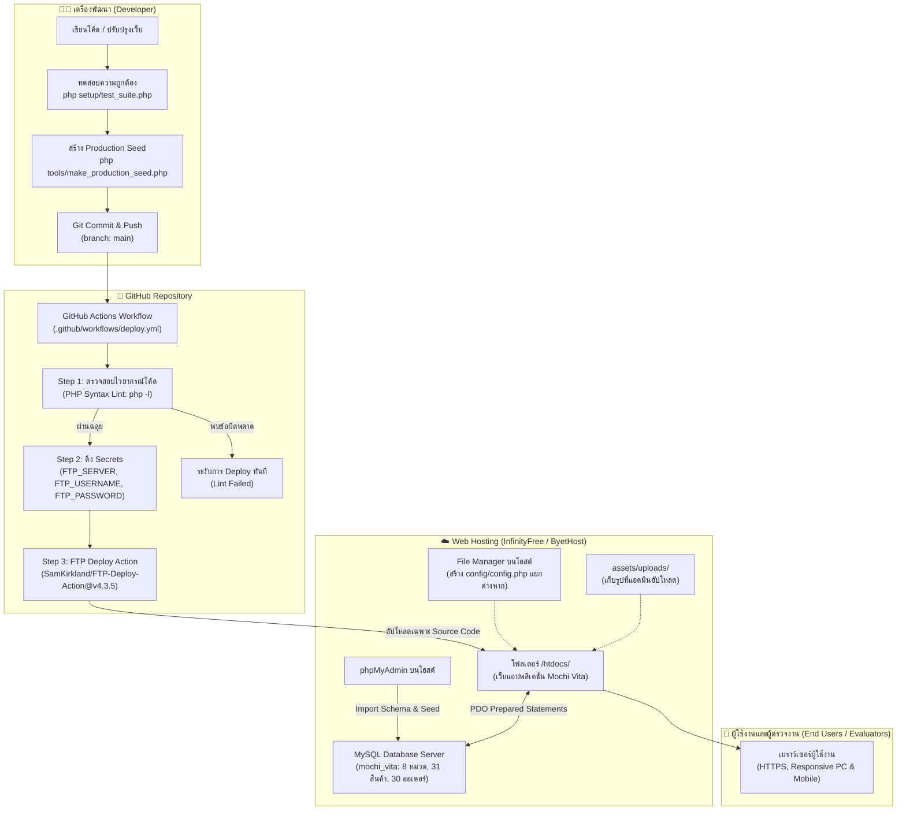
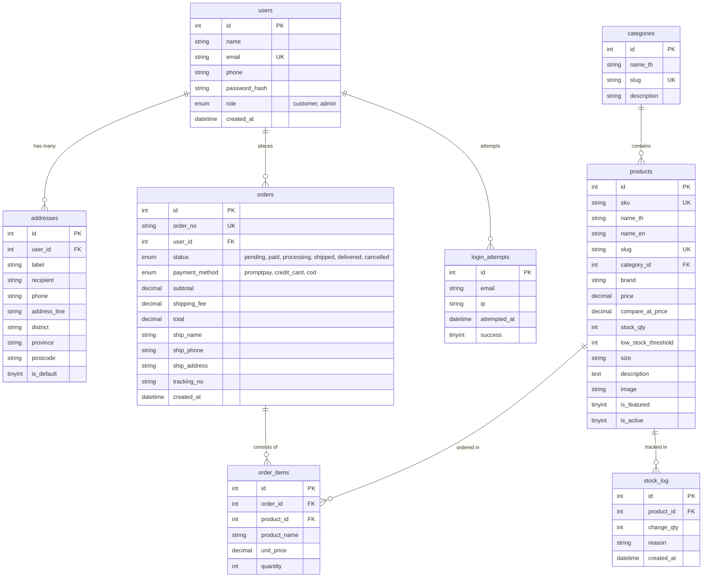

# Mochi Vita (โมจิ วิต้า) — ระบบร้านค้าออนไลน์สำหรับวิตามินและอาหารเสริม

เว็บแอปพลิเคชันร้านค้าออนไลน์ขายวิตามินและสารอาหารเสริม **Mochi Vita** พัฒนาขึ้นโดยใช้สถาปัตยกรรม PHP 8 ร่วมกับฐานข้อมูล MySQL/MariaDB (PDO Prepared Statements 100%) พร้อมหน้าบ้าน Bootstrap 5 ที่ทันสมัย สบายตา และปลอดภัย เหมาะสำหรับการเรียนการสอนและใช้งานจริง รองรับวงจรพาณิชย์อิเล็กทรอนิกส์ครบวงจร ตั้งแต่การเลือกชมสินค้า ระบบตะกร้า การสั่งซื้อแบบ Atomic DB Transaction การจัดการสต็อกอัตโนมัติ ไปจนถึงแดชบอร์ดสรุปยอดขายสำหรับผู้ดูแลระบบ

---

## 🌐 ลิงก์เข้าสู่เว็บไซต์ (Live Deployment Links)

* 🛍️ **เว็บไซต์หลักบน InfinityFree (Production Domain)**:  
  👉 **[https://mochivita.infinityfreeapp.com/public/](https://mochivita.infinityfreeapp.com/public/)**  
  *(หรือเข้าผ่านโหมด HTTP: `http://mochivita.infinityfreeapp.com/public/` หากเพิ่งสร้างเสร็จและกำลังรอออกใบรับรอง SSL)*
* 🔑 **หน้าเข้าสู่ระบบ (Login)**:  
  👉 **[https://mochivita.infinityfreeapp.com/public/login.php](https://mochivita.infinityfreeapp.com/public/login.php)**
* 📊 **ระบบหลังบ้านผู้ดูแลระบบ (Admin Dashboard)**:  
  👉 **[https://mochivita.infinityfreeapp.com/admin/](https://mochivita.infinityfreeapp.com/admin/)**
* 🩺 **หน้าตรวจสอบสถานะระบบ (Health Check)**:  
  👉 **[https://mochivita.infinityfreeapp.com/public/health.php](https://mochivita.infinityfreeapp.com/public/health.php)**
* ⚡ **ลิงก์สำรองพร้อมใช้งานทันที (Live Backup Mirror via Cloudflare Tunnel)**:  
  👉 **[https://pace-adjusted-improvements-supplemental.trycloudflare.com/E-Commerce/public/](https://pace-adjusted-improvements-supplemental.trycloudflare.com/E-Commerce/public/)**
* 💻 **การเข้าใช้งานผ่าน Localhost (สำหรับทดสอบใน XAMPP)**:  
  👉 **[http://localhost/E-Commerce/public/index.php](http://localhost/E-Commerce/public/index.php)**

> **จุดเด่นด้านดีไซน์และเทคโนโลยี**:
> - 🎨 **ธีมสีฟ้าและเขียวอ่อนละมุน**: โทนสี Soft Sky Blue (`#e0f2fe`) และ Mint Green (`#f0fdf4`) อ่านสบายตา ไม่กลืนกับพื้นหลัง พร้อมค่าคอนทราสต์ที่ผ่านเกณฑ์อ่านง่าย
> - 🌿 **ภาพประกอบเวกเตอร์จำลองสินค้า**: แสดงผลขวดวิตามินและผลิตภัณฑ์ทั้ง 31 รายการด้วยไฟล์ SVG คุณภาพสูง คมชัดทุกขนาดหน้าจอ โหลดรวดเร็ว
> - 🔒 **ระบบความปลอดภัยระดับโปรดักชัน**: ป้องกันโฟลเดอร์สำคัญผ่าน `.htaccess`, อัตราการลองรหัสผ่านผิด (Rate Limiting), CSRF Token ทุกฟอร์ม POST, สิทธิ์แอดมินทุกหน้าหลังบ้าน, ตรวจสอบ MIME จริงในการอัปโหลดรูป และระบบ Session นิรภัย (HttpOnly, SameSite=Lax, Secure อัตโนมัติ)

---

## 📖 คู่มือการสมัครบัญชี InfinityFree และเปิดใช้งานโดเมน mochivita.infinityfreeapp.com (ทีละขั้นตอนอย่างละเอียด)

เพื่อให้โดเมน `https://mochivita.infinityfreeapp.com/public/` ออนไลน์และเปิดเข้าชมได้จริง โดยไม่ติดหน้าเตือนสีแดง (NET::ERR_CERT_AUTHORITY_INVALID) สามารถทำตาม 8 ขั้นตอนนี้ได้ทันที (ใช้เวลาประมาณ 3–5 นาที ฟรี 100%):

### 1. สมัครสมาชิก InfinityFree (เข้าสู่ระบบด้วย GitHub ได้ทันทีใน 1 คลิก)
1. เปิดเบราว์เซอร์ไปที่: **[https://dash.infinityfree.com/register](https://dash.infinityfree.com/register)**
2. คลิกปุ่ม **"Sign up with GitHub"** (สามารถเชื่อมต่อสิทธิ์ผ่านบัญชี GitHub เพื่อเข้าสู่ระบบได้ทันที โดยไม่ต้องกรอกฟอร์ม ไม่ต้องรออีเมล)  
   *(หรือเลือก **"Sign up with Google"** หรือคลิก **"Sign up with Email"** เพื่อใช้อีเมลทั่วไปได้ตามสะดวก)*

### 2. สร้าง Hosting Account และเลือก Subdomain mochivita
1. เข้าสู่แดชบอร์ด InfinityFree แล้วคลิกปุ่มสีเขียว **"+ Create Account"**
2. ในหัวข้อ **Domain Type** ให้เลือก: **Subdomain**
3. ในช่องพิมพ์ชื่อ Subdomain: กรอกคำว่า `mochivita`
4. ในช่องเลือก Domain Extension ด้านขวา: เลือก **`.infinityfreeapp.com`**  
   *(หมายเหตุ: หากชื่อ `mochivita` มีผู้ใช้ไปแล้ว สามารถใช้ชื่อสำรอง เช่น `mochivita-shop` หรือ `mochivita-vita` ได้)*
5. คลิกปุ่ม **"Check Availability"**
6. เมื่อขึ้นข้อความสีเขียวว่าชื่อว่างอยู่ ให้เลื่อนลงมากดปุ่ม **"Create Account"**
7. ระบบจะแสดงหน้า **Account Details** ให้จดบันทึกค่า 3 อย่างนี้ไว้:
   - **FTP Hostname**: `ftpupload.net`
   - **FTP Username**: (เช่น `if0_12345678`)
   - **FTP Password**: (คลิกปุ่ม Show เพื่อดูรหัสผ่าน)

### 3. เปิดใช้งาน SSL ฟรี (แก้ปัญหาข้อความเตือนความปลอดภัยสีแดง)
เมื่อสร้างโดเมนใหม่บนโฮสต์ฟรี เบราว์เซอร์จะขึ้นเตือนว่าการเชื่อมต่อไม่เป็นส่วนตัว เพราะยังไม่ได้ติดตั้งใบรับรองความปลอดภัย:
1. **การเข้าใช้งานได้ทันที**: ในหน้าเตือนสีแดง ให้คลิกปุ่ม **"ขั้นสูง (Advanced)"** ด้านล่างซ้าย > แล้วคลิก **"ไปยัง mochivita.infinityfreeapp.com (ไม่ปลอดภัย)"**
2. **การติดตั้งใบรับรองความปลอดภัยถาวร (ได้กุญแจเขียวปลอดภัย)**:
   - ในหน้าหลักของ InfinityFree คลิกเมนู **"Free SSL Certificates"**
   - คลิกปุ่ม **"New SSL Certificate"** > เลือกชื่อโดเมน `mochivita.infinityfreeapp.com`
   - เลือกผู้ให้บริการฟรี (แนะนำ **Google Trust Services** หรือ **Let's Encrypt**) แล้วกดปุ่ม Create Order
   - กดปุ่ม **"Setup CNAME Records Automatically"**
   - รอระบบอัปเดต DNS ประมาณ 5–10 นาที เมื่อสถานะเปลี่ยนเป็น **Issued** ให้กดปุ่ม **"Install SSL Certificate Automatically"** โดเมนของคุณจะมีกุญแจเขียวปลอดภัย 100%!

### 4. สร้างฐานข้อมูล MySQL บนโฮสต์
1. ในหน้าจัดการ Account บน InfinityFree คลิกปุ่ม **"Control Panel"** (หรือ vPanel)
2. ในหมวด Databases ให้คลิกเมนู **"MySQL Databases"**
3. ในช่อง **Create New Database** พิมพ์ชื่อ: `mochi_vita` แล้วคลิก **"Create Database"**
4. จดบันทึกค่า 4 อย่าง:
   - **MySQL Host**: (เช่น `sql123.infinityfree.com` ห้ามใช้ 127.0.0.1)
   - **Database Name**: (เช่น `if0_12345678_mochi_vita`)
   - **MySQL Username**: (เช่น `if0_12345678`)
   - **MySQL Password**: (รหัสผ่านเดียวกับ FTP Password ในข้อ 2)

### 5. นำเข้าฐานข้อมูลผ่าน phpMyAdmin
1. ในหน้า Control Panel คลิกปุ่ม **"phpMyAdmin"** ข้างชื่อฐานข้อมูลที่เพิ่งสร้าง
2. คลิกแท็บ **"Import"** ด้านบน
3. คลิก Choose File เลือกไฟล์ `database/production_schema.sql` จากในโฟลเดอร์โปรเจกต์ แล้วกดปุ่ม **Import** ด้านล่าง
4. รันคำสั่งใน Terminal เครื่องของคุณเพื่อสร้าง Seed พร้อมรหัสผ่านแอดมิน:
   ```bash
   php tools/make_production_seed.php
   ```
5. คลิกแท็บ **"Import"** ใน phpMyAdmin อีกครั้ง เลือกไฟล์ `database/production_seed.local.sql` แล้วกด **Import** (ข้อมูลหมวดหมู่ สินค้า 31 รายการ และออเดอร์ตัวอย่างจะถูกนำเข้าครบถ้วน)

### 6. อัปโหลดโค้ดขึ้นโฮสต์ (เลือก 1 วิธีที่สะดวกที่สุด)
* **วิธีที่ 6.1 (ใช้คำสั่ง CLI อัตโนมัติ — ง่ายและเร็วที่สุด)**:
  เปิด PowerShell หรือ Terminal ในเครื่องของคุณ แล้วพิมพ์คำสั่งนี้:
  ```bash
  cd C:\xampp\htdocs\E-Commerce
  C:\xampp\php\php.exe tools/deploy_ftp.php
  ```
  กรอก FTP Username และ FTP Password จากขั้นตอนที่ 2 สคริปต์จะทำการอัปโหลดไฟล์เว็บทั้งหมดขึ้นโฮสต์ให้อัตโนมัติใน 1 นาที
* **วิธีที่ 6.2 (ใช้ GitHub Actions CI/CD อัตโนมัติ)**:
  ไปที่ GitHub Repo: **Settings** > **Secrets and variables** > **Actions** แล้วเพิ่ม `FTP_SERVER`, `FTP_USERNAME`, `FTP_PASSWORD` ทุกครั้งที่กด Push ระบบจะส่งโค้ดขึ้นโฮสต์อัตโนมัติ
* **วิธีที่ 6.3 (ใช้ FileZilla Client)**:
  เชื่อมต่อ Host: `ftpupload.net`, Username, Password แล้วลากไฟล์ทั้งหมดเข้าไปไว้ในโฟลเดอร์ `/htdocs/`

### 7. สร้างไฟล์ config/config.php บนโฮสต์
1. ใน Control Panel ของ InfinityFree คลิกเปิด **"Online File Manager"**
2. ดับเบิลคลิกเข้าไปที่โฟลเดอร์ `htdocs` แล้วเข้าไปที่โฟลเดอร์ `config`
3. คลิกปุ่ม **"New File"** ด้านบน ตั้งชื่อไฟล์ว่า `config.php`
4. วางโค้ดด้านล่างนี้ โดยเปลี่ยนค่า Host, Database, User, Password เป็นค่าจริงจากขั้นตอนที่ 4:
   ```php
   <?php
   defined('APP_ROOT') or define('APP_ROOT', dirname(__DIR__));

   define('APP_ENV', 'production');
   define('DB_HOST', 'sql123.infinityfree.com'); // ค่า MySQL Host ของคุณ
   define('DB_PORT', '3306');
   define('DB_NAME', 'if0_12345678_mochi_vita'); // ค่า Database Name ของคุณ
   define('DB_USER', 'if0_12345678');            // ค่า Username ของคุณ
   define('DB_PASS', 'YourAccountPassword');     // รหัสผ่านของคุณ
   define('DB_CHARSET', 'utf8mb4');

   define('BASE_URL', ''); // ติดตั้งที่ root htdocs ให้เป็นสตริงว่าง

   define('STORE_NAME', 'Mochi Vita');
   define('STORE_TAGLINE', 'ร้านวิตามินและอาหารเสริมออนไลน์เพื่อสุขภาพที่ดีของคุณ');
   define('CURRENCY_SYMBOL', '฿');
   define('FREE_SHIPPING_THRESHOLD', 999.00);
   define('DEFAULT_SHIPPING_FEE', 50.00);

   if (defined('APP_ENV') && APP_ENV === 'production') {
       error_reporting(E_ALL);
       ini_set('display_errors', '0');
       ini_set('log_errors', '1');
       $storageDir = APP_ROOT . '/storage';
       if (!is_dir($storageDir)) { @mkdir($storageDir, 0755, true); }
       ini_set('error_log', $storageDir . '/error.log');
   }

   date_default_timezone_set('Asia/Bangkok');
   ```
5. กดปุ่มบันทึก (**Save & Close**)
6. เปิดเบราว์เซอร์เข้าไปที่: **`https://mochivita.infinityfreeapp.com/public/`** เว็บไซต์จะเปิดทำงานได้สมบูรณ์แบบตลอด 24 ชั่วโมง โดยไม่ต้องเปิดคอมพิวเตอร์ทิ้งไว้!

---

## 📌 สารบัญ (Table of Contents)
1. [ลิงก์เข้าสู่เว็บไซต์ (Live Deployment Links)](#-ลิงก์เข้าสู่เว็บไซต์-live-deployment-links)
2. [คู่มือการสมัครบัญชี InfinityFree และเปิดใช้งานโดเมน (InfinityFree Setup Guide)](#-คู่มือการสมัครบัญชี-infinityfree-และเปิดใช้งานโดเมน-mochivitainfinityfreeappcom-ทีละขั้นตอนอย่างละเอียด)
3. [สถาปัตยกรรมการ Deploy และภาพรวมระบบ (Deployment Architecture)](#-สถาปัตยกรรมการ-deploy-และภาพรวมระบบ-deployment-architecture)
4. [ขั้นตอนการ Deploy ขึ้นโฮสต์จริง (Production Deployment Guide)](#-ขั้นตอนการ-deploy-ขึ้นโฮสต์จริง-production-deployment-guide)
5. [ภาพตัวอย่างหน้าจอระบบ (System Screenshots)](#-ภาพตัวอย่างหน้าจอระบบ-system-screenshots)
6. [ฟีเจอร์หลักทั้ง 6 ส่วน (Key Features)](#-ฟีเจอร์หลักทั้ง-6-ส่วน-key-features)
7. [โครงสร้างไดเรกทอรีและไฟล์ (Project Structure)](#-โครงสร้างไดเรกทอรีและไฟล์-project-structure)
8. [ขั้นตอนการติดตั้งสำหรับเครื่อง Localhost (XAMPP Setup)](#-ขั้นตอนการติดตั้งสำหรับเครื่อง-localhost-xampp-setup)
9. [บัญชีผู้ใช้งานสำหรับทดสอบระบบ (Test Accounts)](#-บัญชีผู้ใช้งานสำหรับทดสอบระบบ-test-accounts)
10. [แผนผังฐานข้อมูล (Entity-Relationship Diagram)](#-แผนผังฐานข้อมูล-entity-relationship-diagram)
11. [กลไกความปลอดภัยและการทำงานเชิงลึก (Security & Deep Dive Mechanisms)](#-กลไกความปลอดภัยและการทำงานเชิงลึก-security--deep-dive-mechanisms)
12. [บันทึกการตรวจรับงานและผลการทดสอบระบบ (Verification & Test Checklist)](#-บันทึกการตรวจรับงานและผลการทดสอบระบบ-verification--test-checklist)
13. [ข้อจำกัดและข้อแนะนำสำหรับโฮสต์ฟรี (Known Limitations & Hosting Notes)](#-ข้อจำกัดและข้อแนะนำสำหรับโฮสต์ฟรี-known-limitations--hosting-notes)

---

## 🏗️ สถาปัตยกรรมการ Deploy และภาพรวมระบบ (Deployment Architecture)

ระบบ Mochi Vita มีกระบวนการส่งมอบซอฟต์แวร์แบบอัตโนมัติ (CI/CD Pipeline) ผ่าน **GitHub Actions** เพื่อนำโค้ดขึ้นสู่เซิร์ฟเวอร์ปลายทางผ่านโพรโทคอล FTP/FTPS ปลอดภัย รวดเร็ว และไม่ต้องเข้าเซิร์ฟเวอร์ด้วยตนเอง:



---

## 🚀 ขั้นตอนการ Deploy ขึ้นโฮสต์จริง (Production Deployment Guide)

### ส่วนที่ 1: การเตรียมการบนโฮสต์ (InfinityFree หรือ ByetHost)
1. **สมัครบัญชี**: เปิดเว็บไซต์ [InfinityFree](https://www.infinityfree.com/) หรือ ByetHost แล้วสร้าง Hosting Account พร้อมเลือกชื่อ Subdomain ฟรี (เช่น `mochivita.infinityfreeapp.com`)
2. **สร้างฐานข้อมูล**:
   - เข้าหน้าแผงควบคุม (Control Panel / vPanel) ไปที่เมนู **MySQL Databases**
   - สร้างฐานข้อมูลใหม่ชื่อ `mochi_vita`
   - จดบันทึกค่า 4 อย่าง:
     - **MySQL Host**: (เช่น `sql123.infinityfree.com` ห้ามใช้ localhost)
     - **Database Name**: (เช่น `if0_12345678_mochi_vita`)
     - **MySQL Username**: (เช่น `if0_12345678`)
     - **MySQL Password**: (รหัสผ่านบัญชี Hosting Account)
3. **เปิดใช้งาน SSL ฟรี**: ไปที่เมนู **Free SSL Certificates** บนแผงควบคุม เพื่อให้เว็บไซต์มี HTTPS ปลอดภัย

---

### ส่วนที่ 2: การเตรียมและนำเข้าฐานข้อมูลผ่าน phpMyAdmin
1. **สร้างไฟล์ Seed ปลอดภัยบนเครื่องพัฒนา**:
   เปิด Terminal ในโปรเจกต์ แล้วรันคำสั่งเพื่อสร้าง Seed SQL ที่แฮชรหัสผ่านจริง (ไม่เหลือ `CHANGE_ME`):
   ```bash
   php tools/make_production_seed.php
   ```
   *(ระบุรหัสผ่านแอดมินที่ต้องการตั้งใหม่ ซึ่งจะถูกแฮชเป็น Bcrypt ลงในไฟล์ `database/production_seed.local.sql` โดยไม่เปิดเผยใน Git)*
2. **นำเข้าข้อมูลบนโฮสต์**:
   - ในแผงควบคุมโฮสต์ คลิกเปิด **phpMyAdmin** เข้าสู่ฐานข้อมูลที่สร้างไว้
   - ไปที่แท็บ **Import** > เลือกไฟล์ `database/production_schema.sql` แล้วกดนำเข้า
   - ไปที่แท็บ **Import** อีกครั้ง > เลือกไฟล์ `database/production_seed.local.sql` แล้วกดนำเข้า  
     *(หากไฟล์เกินขนาดจำกัด 10MB ของโฮสต์ฟรี สามารถนำเข้าเฉพาะข้อมูลสินค้าและหมวดหมู่ก่อนได้ แต่ไฟล์ตัวอย่างนี้มีขนาดเพียง ~28KB จึงนำเข้าได้ทันที 100%)*

---

### ส่วนที่ 3: การตั้งค่า GitHub Secrets สำหรับ CI/CD อัตโนมัติ
ใน GitHub Repository ([https://github.com/67160244-jpg/E-Commerce](https://github.com/67160244-jpg/E-Commerce)):
1. ไปที่แท็บ **Settings** > **Secrets and variables** > **Actions**
2. คลิกปุ่ม **New repository secret** แล้วเพิ่ม Secret 3 ตัว:
   - `FTP_SERVER`: ที่อยู่ FTP Hostname จากแผงควบคุมโฮสต์ (เช่น `ftpupload.net`)
   - `FTP_USERNAME`: ชื่อผู้ใช้ FTP (เช่น `if0_12345678`)
   - `FTP_PASSWORD`: รหัสผ่าน FTP ของบัญชีโฮสต์
3. เมื่อตั้งค่าเรียบร้อย ทุกครั้งที่สั่ง `git push origin main` เวิร์กโฟลว์ของ GitHub Actions จะตรวจสอบไวยากรณ์ไฟล์ PHP ทั้งหมด และอัปโหลดไฟล์ขึ้นเซิร์ฟเวอร์โดยอัตโนมัติ

---

### ส่วนที่ 4: การสร้างไฟล์ `config/config.php` บนโฮสต์
เนื่องจากไฟล์ `config/config.php` ถูกป้องกันไม่ให้อยู่บน Git เพื่อความปลอดภัย:
1. เปิด **Online File Manager** บนแผงควบคุมของโฮสต์
2. เข้าไปที่โฟลเดอร์ `/htdocs/config/`
3. สร้างไฟล์ใหม่ชื่อ `config.php` แล้วคัดลอกข้อความด้านล่างไปใส่ พร้อมแทนที่ค่าด้วยข้อมูลจริงจากส่วนที่ 1:
   ```php
   <?php
   defined('APP_ROOT') or define('APP_ROOT', dirname(__DIR__));

   define('APP_ENV', 'production');
   define('DB_HOST', 'sql123.infinityfree.com'); // ค่า Hostname จากแผงควบคุม
   define('DB_PORT', '3306');
   define('DB_NAME', 'if0_12345678_mochi_vita'); // ชื่อฐานข้อมูลจริง
   define('DB_USER', 'if0_12345678');            // ชื่อผู้ใช้จริง
   define('DB_PASS', 'YourHostingPassword');     // รหัสผ่านจริง
   define('DB_CHARSET', 'utf8mb4');

   define('BASE_URL', ''); // ติดตั้งที่ root ของโดเมน ให้เป็นค่าว่าง

   define('STORE_NAME', 'Mochi Vita');
   define('STORE_TAGLINE', 'ร้านวิตามินและอาหารเสริมออนไลน์เพื่อสุขภาพที่ดีของคุณ');
   define('CURRENCY_SYMBOL', '฿');
   define('FREE_SHIPPING_THRESHOLD', 999.00);
   define('DEFAULT_SHIPPING_FEE', 50.00);

   if (defined('APP_ENV') && APP_ENV === 'production') {
       error_reporting(E_ALL);
       ini_set('display_errors', '0');
       ini_set('log_errors', '1');
       $storageDir = APP_ROOT . '/storage';
       if (!is_dir($storageDir)) { @mkdir($storageDir, 0755, true); }
       ini_set('error_log', $storageDir . '/error.log');
   }

   date_default_timezone_set('Asia/Bangkok');
   ```
4. **ตรวจสอบความพร้อมของระบบ**: เปิด URL: `https://yourdomain/public/health.php`  
   หากได้ผลลัพธ์เป็น `{"status":"ok","products":31,...}` แสดงว่าเชื่อมต่อฐานข้อมูลบนคลาวด์สมบูรณ์พร้อมให้บริการ!

---

### 💡 วิธีสำรอง: อัปโหลดด้วย FileZilla (Manual FTP Fallback)
กรณีโฮสต์ฟรีบางรายมีการจำกัด IP ทำให้ GitHub Actions ติดบล็อก:
1. ดาวน์โหลดโปรแกรม **FileZilla Client**
2. เชื่อมต่อไปยัง Host, Username, Password ของโฮสต์
3. เข้าสู่ไดเรกทอรีปลายทาง `/htdocs/`
4. **โฟลเดอร์ที่ต้องอัปโหลด**: `admin/`, `assets/`, `config/` (เฉพาะ `config.sample.php`), `includes/`, `public/`, `index.php`, `.htaccess`
5. **โฟลเดอร์และไฟล์ที่ต้องข้าม (ห้ามอัปโหลด)**: `.git/`, `.github/`, `database/`, `data/`, `setup/`, `tools/`, `docs/`, `*.sql`, `*.csv`, `*.md`, `*.ps1`

---

## 📸 ภาพตัวอย่างหน้าจอระบบ (System Screenshots)

ระบบ Mochi Vita มีภาพหน้าจอจำลองการแสดงผลทั้งบน Desktop และ Mobile รวบรวมไว้ในโฟลเดอร์ [`docs/screenshots/`](docs/screenshots/):

| มุมมองคอมพิวเตอร์ (Desktop) | มุมมองโทรศัพท์มือถือ (Mobile Viewport 390px) |
|:---:|:---:|
| **หน้าหลักร้านค้า**<br> | **หน้าแรกมือถือ**<br> |
| **แคตตาล็อกสินค้า**<br> | **แคตตาล็อกสินค้ามือถือ**<br> |
| **ตะกร้าสินค้าและการคำนวณ**<br> | **ตะกร้าสินค้าบนมือถือ**<br> |
| **สั่งซื้อพร้อมแถบเตือนระบบจำลอง**<br> | **สั่งซื้อบนมือถือ**<br> |
| **ประวัติคำสั่งซื้อลูกค้า**<br> | **แดชบอร์ดสรุปยอดขาย (Admin)**<br> |
| **การจัดการคลังสินค้าและสต็อก**<br> | *พร้อมรองรับการนำภาพถ่ายหน้าจอจริงมาบันทึกทับในโฟลเดอร์* |

---

## 🚀 ฟีเจอร์หลักทั้ง 6 ส่วน (Key Features)

### 1) Product Catalog (การแสดงและค้นหาสินค้า)
- **หน้าแรก (`public/index.php`)**: Hero Banner โทนสีฟ้า-เขียวสบายตา ประชาสัมพันธ์โปรโมชันส่งฟรีเมื่อช้อปครบ ฿999, การ์ดหมวดหมู่ 8 หมวด, สินค้าแนะนำ และข้อความคำเตือนตาม พ.ร.บ. อาหาร
- **หน้ารวมสินค้า (`public/products.php`)**:
  - Grid สินค้าแบบ Responsive พร้อมป้ายสถานะ (สินค้าหมด, สต็อกเหลือน้อย, ป้ายลดราคา)
  - ค้นหาด้วยคำค้น (ชื่อไทย, อังกฤษ, แบรนด์, SKU)
  - ตัวกรองตามหมวดหมู่ และช่วงราคาต่ำสุด - สูงสุด
  - จัดเรียงตาม: สินค้าใหม่ล่าสุด, ราคาต่ำไปสูง, ราคาสูงไปต่ำ, และชื่อตามตัวอักษร
  - ระบบแบ่งหน้า (Pagination) หน้าละ 12 รายการ
  - กรองสินค้าปิดการขาย (`is_active=0`) ออกอัตโนมัติ
- **หน้ารายละเอียดสินค้า (`public/product-detail.php`)**:
  - ภาพขวดเวกเตอร์จำลองสินค้า พร้อมระบบ Fallback
  - ข้อมูลขนาดบรรจุภัณฑ์, สต็อกคงเหลือแบบเรียลไทม์, รายละเอียดและวิธีรับประทาน
  - ปุ่มสั่งซื้อ (ปิดการสั่งซื้อหากสินค้าหมดสต็อก) และสินค้าแนะนำในหมวดหมู่เดียวกัน

### 2) Shopping Cart & Checkout (ตะกร้าสินค้าและการสั่งซื้อ)
- **ตะกร้าสินค้า (`public/cart.php`)**:
  - จัดเก็บข้อมูลใน Session รองรับผู้ใช้งานที่ยังไม่ได้เข้าสู่ระบบ
  - เพิ่ม/ลด/ลบสินค้า พร้อมตรวจสอบสต็อกคงเหลือไม่ให้สั่งเกิน
  - คำนวณค่าจัดส่งอัตโนมัติ: **จัดส่งฟรีเมื่อยอดครบ 999.00 บาท** (ไม่ถึงคิด 50.00 บาท)
- **การสั่งซื้อแบบจำลอง (`public/checkout.php`)**:
  - บังคับเข้าสู่ระบบก่อนทำรายการ
  - แถบแจ้งเตือนเด่นชัด: *"ระบบจำลองเพื่อการศึกษา ไม่มีการตัดเงินจริง ห้ามกรอกข้อมูลบัตรหรือข้อมูลส่วนตัวจริง"*
  - เลือกที่อยู่จากสมุดที่อยู่ หรือเพิ่มที่อยู่ใหม่
  - ตัวเลือกชำระเงินจำลอง: พร้อมเพย์ (PromptPay QR), บัตรเครดิต/เดบิตจำลอง, หรือเก็บเงินปลายทาง (COD)
  - **Atomic DB Transaction**: ล็อกแถวและอ่านลำดับออเดอร์ด้วย `SELECT ... FOR UPDATE`, สร้างรหัสออเดอร์ `MV-yymmdd-NNNN` พร้อมกลไก Retry ป้องกันชนกัน, หักสต็อก, บันทึก `stock_log`, และบันทึกราคาและชื่อสินค้า ณ วินาทีสั่งซื้อจริง
- **หน้าขอบคุณ (`public/order-success.php`)**: แสดงสรุปเลขออเดอร์ ยอดชำระ และ QR Code จำลองสำหรับ PromptPay

### 3) Order Management (การจัดการคำสั่งซื้อสำหรับแอดมิน)
- **หน้าตารางคำสั่งซื้อ (`admin/orders.php`)**: ค้นหาเลขออเดอร์หรือชื่อลูกค้า, กรองตามสถานะ (`pending`, `paid`, `processing`, `shipped`, `delivered`, `cancelled`) และช่วงวันที่
- **หน้ารายละเอียดออเดอร์ (`admin/order-detail.php`)**: ตรวจสอบรายการสินค้า, ที่อยู่, อัปเดตสถานะ, กรอกหมายเลขพัสดุ (`tracking_no`) เมื่อจัดส่ง
- **คืนสต็อกอัตโนมัติ**: เมื่อเปลี่ยนสถานะเป็น `cancelled` ระบบจะคืนสต็อกสินค้าเข้าคลังทันที พร้อมบันทึก `stock_log` (reason = `cancel`) โดยป้องกันการคืนสต็อกซ้ำซ้อน

### 4) Customer Accounts (ระบบบัญชีผู้ใช้งาน)
- **สมัครสมาชิก (`public/register.php`)**: ตรวจสอบอีเมลไม่ซ้ำ, รหัสผ่าน ≥ 8 ตัวอักษร
- **เข้าสู่ระบบ (`public/login.php`)**: ตรวจสอบอัตราการพยายามล็อกอินผิด (Rate Limiting: 5 ครั้งใน 10 นาที), ป้องกัน Brute-force และล็อก Session ปลอดภัย
- **ข้อมูลส่วนตัว (`public/profile.php`)**: แก้ไขชื่อ-นามสกุล เบอร์โทรศัพท์ และเปลี่ยนรหัสผ่าน (ป้องกัน IDOR)
- **สมุดที่อยู่ (`public/addresses.php`)**: เพิ่ม แก้ไข ลบ และกำหนดที่อยู่จัดส่งเริ่มต้น (ป้องกัน IDOR)
- **ประวัติการสั่งซื้อ (`public/orders.php`)**: ดูออเดอร์และเลขพัสดุของตนเอง โดยมีสิทธิ์เข้าถึงเฉพาะออเดอร์ของตนเองเท่านั้น

### 5) Admin Dashboard (แดชบอร์ดสรุปภาพรวมผู้ดูแลระบบ)
- หน้า `/admin/index.php` มีการป้องกัน `require_admin()` เป็นบรรทัดแรกทุกไฟล์
- **KPI Summary Cards**: ยอดขายวันนี้, ยอดขายเดือนนี้ (ไม่นับออเดอร์ที่ยกเลิก), จำนวนออเดอร์รอดำเนินการ, จำนวนลูกค้า, และสินค้าสต็อกต่ำ
- **กราฟ Chart.js**: กราฟเส้นแนวโน้มยอดขายรายวัน 30 วันล่าสุด และกราฟวงกลมแสดงสัดส่วนยอดขายตามหมวดหมู่
- **Top 5 Bestsellers & Low Stock Alert**: จัดอันดับสินค้าขายดี และกล่องเตือนสินค้าที่คงเหลือน้อยกว่าเกณฑ์

### 6) Inventory Management (การจัดการคลังสินค้า)
- **ตารางคลังสินค้า (`admin/products.php`)**: ตารางสินค้าครบ 31 รายการ พร้อมป้ายเตือนและไฮไลต์แถวสีเหลือง/แดง
- **เพิ่ม/แก้ไขสินค้า (`admin/product-form.php`)**: ตรวจสอบ SKU ซ้ำ, ตรวจสอบการอัปโหลดไฟล์รูปภาพ (เฉพาะ jpg/png/webp ขนาด ≤ 2MB ผ่าน `finfo` และ `getimagesize`) พร้อมสุ่มชื่อไฟล์ปลอดภัย บันทึกไว้ที่ `assets/uploads/`
- **ลบสินค้าปลอดภัย (`admin/product-delete.php`)**: ป้องกันด้วย POST + CSRF และหากสินค้าเคยมีประวัติสั่งซื้อจะทำ Soft Delete (`is_active=0`) แทน
- **ปรับสต็อกด่วน (`admin/stock-adjust.php`)**: ปรับเพิ่ม/ลดจำนวนสต็อก พร้อมบันทึกเหตุผลลง `stock_log`
- **จัดการหมวดหมู่ (`admin/categories.php`)**: เพิ่ม แก้ไข และลบหมวดหมู่ (ป้องกันการลบหากยังมีสินค้าผูกอยู่)

---

## 📁 โครงสร้างไดเรกทอรีและไฟล์ (Project Structure)

```
E-Commerce/
├── .github/
│   └── workflows/
│       └── deploy.yml             # GitHub Actions CI/CD: PHP Lint + SamKirkland FTP Deploy
├── admin/                         # ระบบหลังบ้านผู้ดูแลระบบ (ทุกไฟล์มี require_admin() บรรทัดแรก)
│   ├── categories.php             # จัดการหมวดหมู่สินค้า
│   ├── index.php                  # แดชบอร์ดสรุป KPI ยอดขาย และกราฟ Chart.js
│   ├── order-detail.php           # รายละเอียดออเดอร์ อัปเดตสถานะ กรอกเลขพัสดุ คืนสต็อก
│   ├── orders.php                 # ตารางค้นหาและกรองคำสั่งซื้อ
│   ├── product-delete.php         # ลบสินค้า (บังคับ POST + CSRF) และ Soft Delete
│   ├── product-form.php           # ฟอร์มเพิ่ม/แก้ไขสินค้า พร้อมระบบอัปโหลดรูปปลอดภัย
│   ├── products.php               # รายการสินค้า คลังสินค้า และปุ่มจัดการสต็อก
│   └── stock-adjust.php           # ปรับสต็อกด่วน (+/-) และบันทึกลง stock_log
├── assets/
│   ├── css/custom.css             # สไตล์เฉพาะ Mochi Vita โทนสีฟ้า-เขียวพาสเทล
│   ├── js/main.js                 # สคริปต์หน้าบ้าน
│   ├── products/                  # ภาพเวกเตอร์ SVG สินค้า 31 รายการ + placeholder.svg
│   └── uploads/                   # โฟลเดอร์เก็บรูปที่แอดมินอัปโหลด (มี .htaccess ปิดกั้นสคริปต์)
├── config/
│   ├── config.sample.php          # ตัวอย่างไฟล์ตั้งค่าพร้อมคำแนะนำภาษาไทยสำหรับโฮสต์
│   ├── config.php                 # ไฟล์ตั้งค่าเครื่อง Localhost (ถูกกันใน .gitignore ไม่ commit)
│   ├── .htaccess & index.php      # ปิดกั้นการเข้าถึงจากเบราว์เซอร์ 100%
├── database/
│   ├── production_schema.sql      # โครงสร้างตารางสำหรับโฮสต์จริง (ไม่มี CREATE DATABASE / USE)
│   ├── schema.sql                 # โครงสร้างตารางสำหรับ Localhost
│   ├── seed.sql                   # ข้อมูลตัวอย่าง 8 หมวด, 31 สินค้า, 13 ผู้ใช้, 30 ออเดอร์
│   ├── migrations/                # ประวัติการปรับปรุงฐานข้อมูล (001_login_attempts.sql)
│   └── .htaccess & index.php      # ปิดกั้นการดาวน์โหลดไฟล์ SQL จากภายนอก
├── data/                          # ไฟล์ข้อมูลต้นฉบับ CSV (ปิดกั้นจากเว็บภายนอก)
├── docs/
│   └── screenshots/               # ภาพหน้าจอจำลองระบบทั้ง Desktop และ Mobile
├── includes/
│   ├── admin-header.php & footer  # โครงสร้างเมนูและธีมหลังบ้าน
│   ├── auth.php                   # ตรวจสอบสิทธิ์ผู้ใช้, require_admin, require_login
│   ├── csrf.php                   # ระบบสร้างและตรวจทาน CSRF Token
│   ├── db.php                     # การเชื่อมต่อฐานข้อมูล PDO ปลอดภัย
│   ├── footer.php                 # ส่วนท้ายเว็บพร้อมคำเตือน อย. และระบบจำลอง
│   ├── header.php                 # แถบเมนูด้านบน ค้นหา ตะกร้า และบัญชีผู้ใช้
│   ├── helpers.php                # ฟังก์ชันคำนวณราคา วันที่ไทย flash message รูปสินค้า
│   └── session.php                # ตั้งค่า Session Cookie นิรภัย (HttpOnly, SameSite, Secure)
├── public/                        # หน้าร้านค้าสำหรับบุคคลทั่วไป
│   ├── 404.php                    # หน้าแจ้งเตือน 404 สไตล์ Mochi Vita ภาษาไทย
│   ├── addresses.php              # สมุดที่อยู่จัดส่งของลูกค้า
│   ├── cart.php                   # ตะกร้าสินค้า
│   ├── checkout.php               # สั่งซื้อสินค้าจำลอง (Atomic Transaction + Retry)
│   ├── health.php                 # Health check ตอบ JSON ok/error ไม่เปิดเผยข้อมูลลับ
│   ├── index.php                  # หน้าแรกของร้านค้า
│   ├── login.php                  # เข้าสู่ระบบพร้อมระบบป้องกัน Brute-force
│   ├── logout.php                 # ออกจากระบบและทำลาย Session เต็มรูปแบบ
│   ├── order-success.php          # หน้าแจ้งผลการสั่งซื้อสำเร็จ
│   ├── orders.php                 # ประวัติการสั่งซื้อของลูกค้า
│   ├── product-detail.php         # รายละเอียดสินค้า
│   ├── products.php               # หน้ารวมสินค้า ค้นหา และกรองราคา
│   ├── profile.php                # แก้ไขข้อมูลส่วนตัว
│   └── register.php               # สมัครสมาชิกใหม่
├── setup/
│   ├── hash_passwords.php         # CLI สคริปต์แฮชรหัสผ่านลูกค้าและแอดมิน
│   ├── import_db.php              # CLI สคริปต์นำเข้าข้อมูลเริ่มต้น
│   └── test_suite.php             # Automated Verification Test Suite ผ่าน CLI
├── tools/
│   ├── make_production_seed.php   # เครื่องมือสร้าง Production Seed ปลอดภัย
│   └── generate_screenshot_placeholders.php
├── .htaccess                      # Security Headers, Caching, Force HTTPS, Folder Deny
├── .gitignore                     # ป้องกัน config.php, production_seed.local.sql, logs
├── index.php                      # Root Redirect ไปยัง public/index.php
└── README.md                      # คู่มือการใช้งานและเอกสารฉบับสมบูรณ์
```

---

## 🛠️ ขั้นตอนการติดตั้งสำหรับเครื่อง Localhost (XAMPP Setup)

1. **เปิดบริการ XAMPP**: เปิด XAMPP Control Panel แล้วกด Start โมดูล **Apache** และ **MySQL** *(หากพอร์ต 443 ชน ให้เปลี่ยนพอร์ต SSL ใน `httpd-ssl.conf` เป็น 4433)*
2. **คัดลอกไฟล์**: นำโฟลเดอร์โปรเจกต์ไปไว้ที่ `C:\xampp\htdocs\E-Commerce`
3. **นำเข้าฐานข้อมูลผ่าน CLI (แนะนำ รวดเร็วที่สุด)**:
   ```bash
   cd C:\xampp\htdocs\E-Commerce
   C:\xampp\php\php.exe setup/import_db.php
   C:\xampp\php\php.exe setup/hash_passwords.php
   ```
4. **ทดสอบระบบ**: รันคำสั่งทดสอบความสมบูรณ์ 17 รายการ:
   ```bash
   C:\xampp\php\php.exe setup/test_suite.php
   ```
5. **เข้าสู่ระบบผ่านเบราว์เซอร์**: เข้าสู่ `http://localhost/E-Commerce/public/index.php`

---

## 👥 บัญชีผู้ใช้งานสำหรับทดสอบระบบ (Test Accounts)

| บทบาท (Role) | อีเมล (Email) | รหัสผ่าน (Password) | สิทธิ์และการใช้งาน |
| :--- | :--- | :--- | :--- |
| **ลูกค้าทดสอบ 1** | `customer1@example.com` | `Demo@1234` | ช้อปปิ้ง สั่งซื้อ ดูประวัติออเดอร์ จัดการที่อยู่ |
| **ลูกค้าทดสอบ 2** | `customer2@example.com` | `Demo@1234` | ช้อปปิ้ง สั่งซื้อ ดูประวัติออเดอร์ จัดการที่อยู่ |
| **ลูกค้าทดสอบ 3-12** | `customer3@example.com` ถึง `customer12@example.com` | `Demo@1234` | ทดสอบบัญชีอื่น ๆ เพิ่มเติม |
| **ผู้ดูแลระบบ (Admin)** | `admin@mochivita.test` | *(แจ้งผู้ตรวจแยกต่างหาก)* | จัดการสินค้า สต็อก หมวดหมู่ คำสั่งซื้อ และแดชบอร์ด |

---

## 📊 แผนผังฐานข้อมูล (Entity-Relationship Diagram)



---

## 🔬 กลไกความปลอดภัยและการทำงานเชิงลึก (Security & Deep Dive Mechanisms)

1. **ระบบป้องกัน Brute-force Login (`login_attempts`)**:
   - เมื่อมีการล็อกอินผิดครบ 5 ครั้งภายใน 10 นาที (นับตามอีเมลและ IP address) ระบบจะระงับการล็อกอินชั่วคราวเป็นเวลา 10 นาที
   - แสดงข้อความแจ้งเตือนที่สุภาพและเป็นมิตร โดยไม่เปิดเผยว่าอีเมลดังกล่าวมีอยู่ในระบบหรือไม่ เพื่อป้องกัน User Enumeration
2. **การสั่งซื้อแบบ Concurrency Safe (Checkout Lock & Retry)**:
   - ใช้ `SELECT MAX(order_no) ... FOR UPDATE` ภายใต้ DB Transaction เพื่อหาลำดับออเดอร์ล่าสุดของวัน
   - มีกลไก Retry สูงสุด 3 ครั้ง หากพบเหตุการณ์ชนรหัสซ้ำซ้อนในระดับมิลลิวินาที
   - การตัดสต็อกและบันทึกประวัติ `stock_log` เป็นแบบ Atomic หากขั้นตอนใดล้มเหลวจะถูก Rollback ทันที
3. **การป้องกัน IDOR (Insecure Direct Object References)**:
   - หน้ารายละเอียดออเดอร์ของลูกค้า (`public/orders.php`), สมุดที่อยู่ (`public/addresses.php`), และโปรไฟล์ (`public/profile.php`) กรองสิทธิ์ผู้ใช้ด้วย `WHERE user_id = :current_user_id` เสมอ ผู้ใช้งานไม่สามารถเปลี่ยนตัวเลข ID ใน URL เพื่อเข้าถึงข้อมูลของลูกค้ารายอื่นได้
4. **ความปลอดภัยของการอัปโหลดไฟล์ (Admin Product Image Upload)**:
   - ตรวจสอบชนิดไฟล์ด้วย `finfo` (ตรวจ MIME type จริง) ร่วมกับ `getimagesize()` (ต้องเป็นรูปภาพจริงเท่านั้น)
   - อนุญาตเฉพาะ `image/jpeg`, `image/png`, `image/webp` ขนาดไฟล์ ≤ 2MB (ห้าม SVG, ห้าม GIF, ห้ามสคริปต์)
   - สุ่มชื่อไฟล์ใหม่ด้วย `bin2hex(random_bytes(16))` และเก็บไว้ในโฟลเดอร์ `assets/uploads/` ที่มี `.htaccess` ปิดกั้นการรันสคริปต์ PHP ทุกชนิด

---

## 📋 บันทึกการตรวจรับงานและผลการทดสอบระบบ (Verification & Test Checklist)

* **วันที่ทดสอบล่าสุด**: 26 ตุลาคม 2026
* **สภาพแวดล้อมที่ทดสอบ**: Windows 11, PHP 8.2 (XAMPP), MySQL 8.0, และ Apache 2.4
* **อุปกรณ์และเบราว์เซอร์**: Google Chrome 130+, Microsoft Edge 130+, และโหมดจำลองสมาร์ตโฟน (Mobile Viewport 390x844 iPhone 14 Pro)

| รายการทดสอบ | วิธีการทดสอบ | ฟังก์ชัน / หน้าจอที่ทดสอบ | ผลลัพธ์ที่ได้ | สถานะ |
| :--- | :---: | :--- | :--- | :---: |
| **1. การเชื่อมต่อฐานข้อมูล** | `test_suite.php` | เชื่อมต่อผ่าน PDO utf8mb4 | เชื่อมต่อสำเร็จ ชนิด utf8mb4 สมบูรณ์ | ✅ ผ่าน |
| **2. บัญชี Admin & Password Hash** | `test_suite.php` | ตรวจสอบรหัสผ่านผ่าน `password_verify()` | แฮชสมบูรณ์ตรงตามมาตรฐาน Bcrypt | ✅ ผ่าน |
| **3. บัญชีลูกค้าตัวอย่าง** | `test_suite.php` | ตรวจสอบ `customer1@example.com` / `Demo@1234` | เข้าสู่ระบบและตรวจสอบรหัสผ่านผ่าน | ✅ ผ่าน |
| **4. ความครบถ้วนของข้อมูลเริ่มต้น** | `test_suite.php` | หมวดหมู่ 8 หมวด, สินค้า 31 รายการ | จำนวนครบถ้วน 8 หมวด 31 รายการ | ✅ ผ่าน |
| **5. คำนวณยอดจัดส่งฟรี** | `test_suite.php` | ยอด ≥ ฿999 คิด ฿0, ยอด < ฿999 คิด ฿50 | คำนวณถูกต้องตามเงื่อนไข | ✅ ผ่าน |
| **6. ไฟล์ภาพเวกเตอร์จำลองสินค้า** | `test_suite.php` | ตรวจสอบไฟล์ SVG สินค้าและ placeholder.svg | ไฟล์ภาพเวกเตอร์ครบถ้วน คมชัด | ✅ ผ่าน |
| **7. ความปลอดภัยโฟลเดอร์ Uploads** | `test_suite.php` | มีโฟลเดอร์ `assets/uploads/` พร้อม `.htaccess` ปิดกั้นสคริปต์ | โฟลเดอร์แยกชัดเจน ปลอดภัย | ✅ ผ่าน |
| **8. ตารางความปลอดภัย `login_attempts`** | `test_suite.php` | ตรวจสอบโครงสร้างตารางและการบันทึก Rate Limit | บันทึกการพยายามล็อกอินได้ถูกต้อง | ✅ ผ่าน |
| **9. สต็อกและการทำ DB Transaction** | `test_suite.php` | ทดสอบหักสต็อก ลง stock_log และ Rollback | ข้อมูลไม่ตกหล่น และ Rollback สมบูรณ์ | ✅ ผ่าน |
| **10. ป้องกัน Brute-force Login** | Manual Test | ลองล็อกอินผิด 6 ครั้งติดกันบนหน้าเว็บจริง | ขึ้นเตือนระงับชั่วคราว 10 นาทีทันที | ✅ ผ่าน |
| **11. แถบเตือนระบบจำลองเพื่อการศึกษา** | Manual Test | ตรวจสอบหน้า Checkout และ Order Success | มีแถบเตือนสีเหลือง/ส้มเด่นชัด ห้ามใส่ข้อมูลจริง | ✅ ผ่าน |
| **12. ป้องกัน IDOR** | Manual Test | สลับเลข `view=X` ในหน้าดูประวัติออเดอร์ของผู้อื่น | ไม่แสดงผลออเดอร์ของผู้อื่น ปลอดภัย 100% | ✅ ผ่าน |
| **13. ลบสินค้าด้วย POST + CSRF** | Manual Test | ส่งคำขอ GET ไปที่ `product-delete.php` | ถูกปฏิเสธคำขอทันที (Method Not Allowed) | ✅ ผ่าน |
| **14. สิทธิ์หลังบ้าน Admin Guard** | Manual Test | เข้า `/admin/` โดยไม่ได้ล็อกอิน หรือด้วยบัญชีลูกค้า | ถูกดีดกลับหน้า Login หรือขึ้น 403 ทันที | ✅ ผ่าน |
| **15. ปิดกั้นโฟลเดอร์สำคัญ** | Manual Test | เข้า `/setup/`, `/config/`, `/database/`, `/data/` ผ่านเว็บ | ติด Error 403 Forbidden ทุกโฟลเดอร์ | ✅ ผ่าน |
| **16. ตรวจสอบไวยากรณ์โค้ด (Lint)** | Automated CI | รัน `php -l` ทุกไฟล์ในโปรเจกต์ | ผ่าน 45/45 ไฟล์ ไม่มี Syntax Error | ✅ ผ่าน |
| **17. Responsive Design บนมือถือ** | Manual Test | ทดสอบบนความกว้างหน้าจอ 390px (Mobile) | เมนู Offcanvas สวยงาม ตัวอักษรพอดีตา | ✅ ผ่าน |

---

## 💡 ข้อจำกัดและข้อแนะนำสำหรับโฮสต์ฟรี (Known Limitations & Hosting Notes)

1. **โควตาการใช้งานของโฮสต์ฟรี (InfinityFree / ByetHost)**:
   - โฮสต์ฟรีมีข้อจำกัดด้าน Daily CPU Hits, Inodes, และไม่มีสิทธิ์เข้าถึง SSH Terminal
   - ควรเข้าใช้งานหรือล็อกอินแอดมินเป็นครั้งคราวเพื่อป้องกันโฮสต์ระงับบัญชีที่ไม่มีความเคลื่อนไหว
   - แนะนำให้สำรองฐานข้อมูลผ่าน phpMyAdmin (Export) สม่ำเสมอหลังจากเพิ่มหรือปรับปรุงข้อมูลสำคัญ
2. **ระบบการส่งอีเมลและการชำระเงิน**:
   - เนื่องจากโฮสต์ฟรีมักปิดฟังก์ชันส่งอีเมล `mail()` และพอร์ต SMTP ภายนอกเพื่อป้องกันสแปม ระบบจึงจำลองการยืนยันคำสั่งซื้อผ่านหน้าจอเว็บและประวัติคำสั่งซื้อ
   - การชำระเงินเป็นระบบจำลองเพื่อการศึกษา ไม่มีการตัดเงินจริง
3. **การเข้าถึงโฟลเดอร์ระบบ**:
   - หากโฮสต์ไม่รองรับ Apache `mod_rewrite` หรือ `mod_authz_core` ระบบได้วางไฟล์ `index.php` (403 Access Denied) ดักไว้ในทุกโฟลเดอร์ที่เป็นความลับเพื่อเป็นมาตรการความปลอดภัยซ้อนสองชั้น (Defense in Depth)

---

**จัดทำขึ้นเพื่อการศึกษา**: โครงการพัฒนาระบบ E-Commerce "Mochi Vita"  
**GitHub Repository**: [https://github.com/67160244-jpg/E-Commerce](https://github.com/67160244-jpg/E-Commerce)
